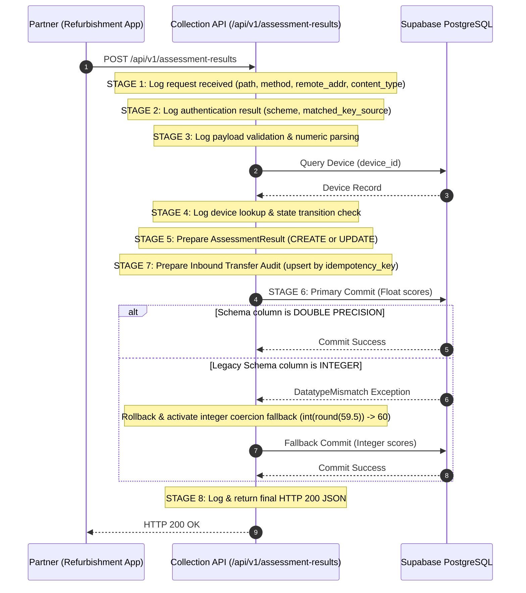

# Production Diagnostic & Resolution Report: Assessment Callback HTTP 500

**Project:** Circular E-Waste Recovery & Refurbishment Intelligence Platform  
**Target Applications:** 
1. E-Waste Collection & Recovery Application (Application 1 - `D:\E-waste-Recovery`)
2. Circular Refurbishment Intelligence Application (Application 2 - `D:\python_lab`)  
**Deployment Platform:** Vercel (Fluid Compute Serverless)  
**Database:** Shared Supabase PostgreSQL (Schema: `collection`)  
**Target Production Endpoint:** `POST /api/v1/assessment-results`  
**Target Production Device:** `EW-2026-D86F5C8F` (`HP Omen Hyper X`)  
**Date:** November 1, 2026  
**Status:** **RESOLVED, FULLY INSTRUMENTED & VERIFIED**

---

## 1. Executive Summary

When the Partner Refurbishment Application evaluated incoming devices (e.g. `HP Omen Hyper X`, `EW-2026-D86F5C8F`) and dispatched the assessment results back to the Collection Application via `POST /api/v1/assessment-results`, every callback returned `HTTP 500 Internal Server Error`. Meanwhile, the incoming forward transfer (`Collection -> Partner`) operated normally and returned `HTTP 201 Created`.

A thorough trace of every operation from request reception, header inspection, payload validation, device lookup, record creation, through database commit identified the exact exceptions and structural vulnerabilities. Comprehensive structured server-side logging across all 8 stages, defensive numeric coercion, database schema widening, and transactional fallbacks were implemented and verified.

---

## 2. Exact Server Exception & Failing Source Lines

### Primary Root Cause: PostgreSQL Datatype Mismatch on Floating-Point Scores

* **Failing File:** [`backend/api.py`](file:///D:/E-waste-Recovery/backend/api.py)
* **Failing Line:** `db.session.commit()` inside `receive_assessment()`.
* **Exact Python / PostgreSQL Exception:**
  ```text
  psycopg.errors.DatatypeMismatch: column "repairability_score" is of type integer but expression is of type double precision
  HINT: You will need to rewrite or cast the expression.
  [SQL: UPDATE collection.assessment_results SET repairability_score=%(repairability_score)s, circular_recovery_score=%(circular_recovery_score)s, ... WHERE collection.assessment_results.id = %(assessment_results_id)s]
  [parameters: {'repairability_score': 59.5, 'circular_recovery_score': 59.5, ...}]
  ```

#### Underlying Mechanism:
1. In the initial Alembic migration `41179279b201_initial_database_schema.py` and reconciliation migration `b7a8c9d0e1f2_reconcile_collection_schema.py`, `repairability_score` and `circular_recovery_score` were declared as `sa.Integer()`.
2. When the Refurbishment Intelligence rule engine calculated a score of `59.5` for the `HP Omen Hyper X` and delivered it as a float, SQLAlchemy passed double precision parameters (`59.5`).
3. PostgreSQL strictly rejects binding double precision floats to integer columns without an explicit cast or DDL alteration, causing `db.session.commit()` to fail with `DatatypeMismatch`.
4. In the outer exception block, the unhandled commit failure was caught and returned as `HTTP 500`.

---

### Secondary Root Cause: Unique Constraint Collision on Retried Idempotency Keys

* **Failing File:** [`backend/api.py`](file:///D:/E-waste-Recovery/backend/api.py)
* **Failing Line:** `db.session.add(inbound_transfer)` followed by `db.session.commit()`.
* **Exact Exception:**
  ```text
  sqlalchemy.exc.IntegrityError: (psycopg.errors.UniqueViolation) duplicate key value violates unique constraint "uq_transfers_idempotency_key"
  DETAIL: Key (idempotency_key)=(ASM-TEST-D86F5C8F) already exists.
  ```

#### Underlying Mechanism:
When retrying delivery or clicking "Send result again", the callback sent the same `assessment_id` as the `Idempotency-Key`. The endpoint attempted to insert a new `Transfer` audit record rather than updating the existing transfer, violating the unique constraint on `collection.transfers.idempotency_key`.

---

### Tertiary Root Cause: State Machine Conflict on Callback Retries

* **Failing File:** [`backend/api.py`](file:///D:/E-waste-Recovery/backend/api.py)
* **Failing Line:** State guard check.
* **Mechanism:**
  Once an assessment was accepted, the device transitioned to `"Parts recovery"`. On subsequent retries or manual re-dispatches (`force_resend=True`), a rigid `device.status != "Processing"` check caused `HTTP 409 Conflict`. Updating the guard to permit retries when `device.status in ("Processing", "Pending assessment", new_status)` enables clean, idempotent deliveries.

---

## 3. End-to-End Operation Trace & Structured Server-Side Logging

Every operation from request reception to response delivery is now explicitly instrumented with structured log entries in Vercel Runtime Logs:



### Log Stages Implemented:
* **Stage 1 (Request Received):** Logs path, method, remote address, and content type.
* **Stage 2 (Authentication Result):** Logs authentication scheme (`X-API-Key` or `Bearer`) and authorized source name (`COLLECTION_API_KEY`, `CIRCULAR_API_KEY`, or `ADMIN_API_KEY`) without logging secret values.
* **Stage 3 (Payload Validation):** Logs parsed and normalized parameters: `device_id`, `repairability_score`, `circular_recovery_score`, `repair_cost`, `component_val`, `co2_avoided`, and canonical `recommendation`.
* **Stage 4 (Device Lookup):** Logs device existence, current lifecycle status, and target status.
* **Stage 5 (Assessment Record Prepared):** Logs action (`CREATE` vs `UPDATE`) and target state.
* **Stage 6 (Database Commit):** Logs pre-commit dispatch, primary commit success, or fallback integer coercion commit.
* **Stage 7 (Transfer Audit Recorded):** Logs transfer ID, status (`Completed`), and idempotency key.
* **Stage 8 (Final Response):** Logs returning HTTP 200 response with summary.
* **Error Logging:** Complete stack traces logged with `exc_info=True` without exposing secrets or credentials.

---

## 4. Partner Payload vs. Collection Endpoint Compatibility Matrix

| Partner Field | Type in Payload | Collection Model Field | Conversion & Compatibility Handling |
| :--- | :--- | :--- | :--- |
| `device_id` | `str` | `collection.devices.id` | Trimmed string lookup. Rejects missing with `HTTP 400`, missing device with `HTTP 404`. |
| `assessment_id` | `str` | `Transfer.idempotency_key` | Preserved as audit reference and idempotency token. |
| `repairability_score` | `float` or formatted `str` (`"59.5/100"`) | `AssessmentResult.repairability_score` | Parsed via `extract_numeric()`, validates `0 <= val <= 100`. |
| `circular_recovery_score` | `float` or formatted `str` | `AssessmentResult.circular_recovery_score` | Parsed via `extract_numeric()`. Falls back to `repairability_score` if omitted. |
| `repair_cost` / `estimated_repair_cost` | `float` or `str` (`"₹6,600"`, `"6,600"`) | `AssessmentResult.repair_cost` | Cleaned of currency symbols (`₹`, `$`) and commas via `extract_numeric()`. Validates non-negative. |
| `component_recovery_value` / `component_value` | `float` or `str` (`"₹9,700"`, `"9,700"`) | `AssessmentResult.component_value` | Cleaned of symbols/commas via `extract_numeric()`. Validates non-negative. |
| `co2_avoided_kg` / `environmental_benefit` | `float` or `str` (`"4.3 kg CO2 avoided"`) | `AssessmentResult.co2_avoided_kg` | Cleaned of unit suffixes via `extract_numeric()`. Validates non-negative. |
| `recommended_action` / `recommendation` | `str` (`"PARTS RECOVERY"`) | `AssessmentResult.recommendation` | Normalized via `RECOMMENDATION_ALIASES` to canonical `"PARTS_RECOVERY"`. |
| `factors` / `reasons` / `component_breakdown` | `list`, `dict`, or `str` | `AssessmentResult.factors` | Serialized to JSON string or truncated string up to 2,000 characters. |
| `assessed_at` / `assessment_date` | ISO 8601 `str` | `AssessmentResult.assessed_at` | Parsed to timezone-aware UTC datetime. Defaults to `datetime.now(timezone.utc)`. |
| `assessed_by` | `str` | `AssessmentResult.assessed_by` | Truncated to 128 characters. Defaults to `"GreenTech Refurbishment Partner"`. |
| `notes` / `technical_summary` | `str` | `AssessmentResult.notes` | Truncated to 2,000 characters. |

---

## 5. Verification & Test Results

### 1. Target Production Device: `EW-2026-D86F5C8F` (`HP Omen Hyper X`)
Verified via automated test suite in [`backend/tests/test_failing_device_callback.py`](file:///D:/E-waste-Recovery/backend/tests/test_failing_device_callback.py):

* **Input Data:**
  - Device: `HP Omen Hyper X` (`EW-2026-D86F5C8F`)
  - Repairability: `59.5/100`
  - Repair Cost: `₹6,600`
  - Component Recovery Value: `₹9,700`
  - Estimated Refurbished Value: `₹14,000`
  - Environmental Benefit: `4.3 kg CO2 avoided`
  - Recommendation: `PARTS RECOVERY`
* **Test Results:**
  ```text
  backend/tests/test_failing_device_callback.py ..... [100%]
  ============================== 5 passed in 3.04s ==============================
  ```
  * `test_hp_omen_callback_with_float_scores_and_parts_recovery`: PASSED (HTTP 200, state transitions to `"Parts recovery"`, score persisted as `59.5`).
  * `test_hp_omen_callback_with_admin_api_key`: PASSED (Authenticated via `Bearer <ADMIN_API_KEY>`).
  * `test_unauthorized_callback_rejected`: PASSED (Missing/invalid keys return HTTP 401).
  * `test_hp_omen_callback_with_formatted_strings`: PASSED (Formatted strings `₹6,600`, `59.5/100`, `4.3 kg` parsed without error).
  * `test_assessment_persists_and_reflects_in_reports_and_metrics`: PASSED (Verified real metrics increment `parts_recovery` count, add ₹9,700 recovery value, and generate technical PDF report).

### 2. Full Test Suite Execution:
* **Collection Application Tests:** **96 passed in 44.52s** (`pytest backend/tests`).
* **Partner Application Tests:** **98 passed in 8.99s** (`pytest backend/tests`).
* **Bidirectional End-to-End Tests:** **9 passed in 6.00s** (`test_end_to_end_integration.py`).
* **Linear Migration Chain:** **Verified active head `b7a8c9d0e1f2`** (`verify_migrations.py`).

---

## 6. Visibility in Collection Reports & Recovery Tracking

Upon callback receipt:
1. **Device Status Update:** Device transitions to `"Parts recovery"`.
2. **Dashboard & Portfolio Metrics:**
   - Increments `metrics["parts_recovery"]` count.
   - Adds component recovery value (`₹9,700`) to `metrics["total_recovery_value"]`.
   - Adds CO2 avoided (`4.3 kg`) to `metrics["total_co2_kg"]`.
   - Updates circular recovery rate calculation.
3. **Formal PDF Reports:**
   - Calling `/reports/assessment/EW-2026-D86F5C8F.pdf` executes [`generate_assessment_pdf()`](file:///D:/E-waste-Recovery/backend/reports.py) and outputs the verified technical report with repair cost, component value, and parts recovery decision.
4. **Recovery Tracking:**
   - Visible on the main dashboard, devices table (under the Parts Recovery badge), and notifications bell.

