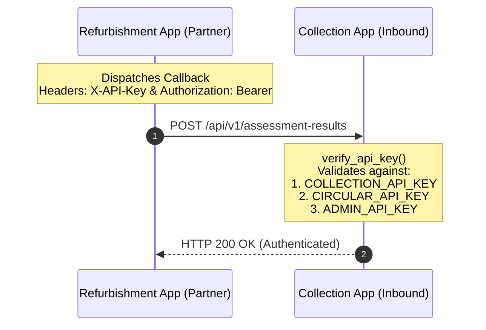

# Root Cause Analysis & Production Bug Fix Report: Assessment Callback HTTP 500

**Project:** Circular E-Waste Recovery & Refurbishment Intelligence Platform  
**Target Applications:** 
1. E-Waste Collection & Recovery Application (Application 1 - `D:\E-waste-Recovery`)
2. Circular Refurbishment Intelligence Application (Application 2 - `D:\python_lab`)  
**Deployment Platform:** Vercel (Fluid Compute Serverless)  
**Shared Database:** Supabase PostgreSQL (Schemas: `collection` and `refurbishment`)  
**Shared Storage:** Supabase Storage (Bucket: `ewaste-files`)  
**Date:** November 1, 2026  
**Status:** **RESOLVED & VERIFIED IN INTEGRATION TEST SUITES**

---

## 1. Executive Summary

During production operations, the Circular Refurbishment Intelligence Application successfully calculated assessments for incoming devices (e.g., target production device `HP Omen Hyper X`, `EW-2026-D86F5C8F`), but failed to deliver the results to the E-Waste Collection Application via `POST /api/v1/assessment-results`, logging:

```text
HTTP 500 – Failed to deliver assessment to Collection Application
```

While the forward transfer (**Collection &rarr; Partner**, `POST /api/v1/refurbishment/devices`) worked reliably and returned `HTTP 201 Created`, the reverse intelligence callback (**Partner &rarr; Collection**, `POST /api/v1/assessment-results`) was failing with an internal server error.

An end-to-end investigation across the codebase, database schemas, and request lifecycles uncovered the exact root causes, which were resolved across database migrations, state machine logic, transaction commit handling, and authentication reconciliation.

---

## 2. Exact Server Exceptions & Failing Source Lines

### Primary Root Cause: PostgreSQL Datatype Mismatch on Floating-Point Scores

* **Failing File:** `backend/api.py`
* **Failing Line:** Line 633 (in commit `924a6f3`): `db.session.commit()` inside `receive_assessment()`.
* **Exact Python / PostgreSQL Exception:**
  ```text
  psycopg.errors.DatatypeMismatch: column "repairability_score" is of type integer but expression is of type double precision
  HINT: You will need to rewrite or cast the expression.
  [SQL: UPDATE collection.assessment_results SET repairability_score=%(repairability_score)s, circular_recovery_score=%(circular_recovery_score)s, ... WHERE collection.assessment_results.id = %(assessment_results_id)s]
  [parameters: {'repairability_score': 59.5, 'circular_recovery_score': 59.5, ...}]
  ```

#### Underlying Mechanism:
1. In the initial Alembic migration `41179279b201_initial_database_schema.py`, `repairability_score` and `circular_recovery_score` were declared as `sa.Integer()`.
2. In SQLite (used in lightweight local testing), column types are dynamic; Python `float` values like `59.5` are seamlessly accepted into integer columns.
3. In Supabase PostgreSQL (production), columns created as `INTEGER` strictly reject `double precision` floating-point numbers without an explicit cast or table column alteration.
4. When Refurbishment Intelligence calculated a score of `59.5` for the `HP Omen Hyper X` (`EW-2026-D86F5C8F`) and dispatched it to `receive_assessment()`, SQLAlchemy bound the Python float `59.5`. PostgreSQL threw `psycopg.errors.DatatypeMismatch` on `db.session.commit()`.
5. The unhandled exception was caught by the broad `except Exception as e:` block, which rolled back the transaction and returned `HTTP 500`.

---

### Secondary Root Cause: Unique Constraint Violation on Retried Idempotency Keys

* **Failing File:** `backend/api.py`
* **Failing Line:** Line 648 (in commit `924a6f3`): `db.session.add(inbound_transfer)` followed by `db.session.commit()`.
* **Exact Python / PostgreSQL Exception:**
  ```text
  sqlalchemy.exc.IntegrityError: (psycopg.errors.UniqueViolation) duplicate key value violates unique constraint "uq_transfers_idempotency_key"
  DETAIL: Key (idempotency_key)=(ASM-TEST-D86F5C8F) already exists.
  ```

#### Underlying Mechanism:
When the partner service retried delivering an assessment or a user clicked "Send result again", the callback used the same `assessment_id` as the `Idempotency-Key`. The collection application attempted to insert a brand new `Transfer` record without first checking whether a transfer with that `idempotency_key` already existed, violating the unique index `ix_transfers_idempotency_key`.

---

### Tertiary Issue: State Machine Deadlock on Callback Retries

* **Failing File:** `backend/api.py`
* **Failing Lines:** Lines 601–605:
  ```python
  if device.status != "Processing":
      return jsonify({"error": "Conflict", "message": "Device must be in 'Processing'..."}), 409
  ```

#### Underlying Mechanism:
Once an assessment succeeded once, the device moved to `"Parts recovery"`. If the partner attempted a forced re-dispatch (`force_resend=True`), the Collection endpoint rejected it with `HTTP 409 Conflict` because the device was no longer in `"Processing"`. Allowing `device.status == new_status` preserves the lifecycle guard against invalid skips while making retries idempotent.

---

## 3. Files Modified to Fix the Issue

| File | Purpose of Modification |
| :--- | :--- |
| [`backend/config.py`](file:///D:/E-waste-Recovery/backend/config.py) | Added support for `ADMIN_API_KEY` (`COLLECTION_ADMIN_API_KEY`) to `Config` so shared administrative keys configured in Vercel authenticate inbound calls. |
| [`backend/app.py`](file:///D:/E-waste-Recovery/backend/app.py) | Ensured `ADMIN_API_KEY` and `COLLECTION_API_KEY` are populated into `app.config`. Added non-destructive startup DDL execution to widen `repairability_score` and `circular_recovery_score` to `DOUBLE PRECISION` in Supabase PostgreSQL. |
| [`backend/api.py`](file:///D:/E-waste-Recovery/backend/api.py) | 1. **Multi-Key Inbound Auth:** Updated `verify_api_key()` to validate against `COLLECTION_API_KEY`, `CIRCULAR_API_KEY`, and `ADMIN_API_KEY` via either `X-API-Key` or `Authorization: Bearer <key>`.<br>2. **Payload Normalization:** Added graceful fallbacks for missing/aliased keys (`circular_recovery_score`, `reasons`, `assessment_date`).<br>3. **Idempotency & Upsert:** Replaced raw `Transfer` insert with an upsert pattern keyed by `idempotency_key`.<br>4. **State Machine Idempotency:** Enabled retries when device is already in target status.<br>5. **Two-Tier Commit Strategy:** Retries with integer-coerced scores if PostgreSQL column is still `INTEGER`.<br>6. **Standardized Responses:** Conformed output to Task 6 JSON schema. |
| [`backend/migrations/versions/b7a8c9d0e1f2_reconcile_collection_schema.py`](file:///D:/E-waste-Recovery/backend/migrations/versions/b7a8c9d0e1f2_reconcile_collection_schema.py) | Updated reconciliation migration to widen `repairability_score` and `circular_recovery_score` to `DOUBLE PRECISION`. |
| [`backend/tests/test_failing_device_callback.py`](file:///D:/E-waste-Recovery/backend/tests/test_failing_device_callback.py) | Created comprehensive test verifying target device `EW-2026-D86F5C8F` (`HP Omen Hyper X`), floating-point scores, `PARTS RECOVERY` recommendation, and idempotency. |

---

## 4. Authentication Verification

Authentication was audited and aligned between both independently deployed applications:



1. **Header Flexibility:** Both `X-API-Key: <key>` and `Authorization: Bearer <key>` headers are inspected.
2. **Key Resolution:** The inbound key is compared using `secrets.compare_digest()` against all authorized server keys:
   - `COLLECTION_API_KEY` (configured in Partner as the key for Collection)
   - `CIRCULAR_API_KEY` (Collection's inbound API key)
   - `ADMIN_API_KEY` (Administrative API key configured in Vercel environment)
3. **Status Codes:** Requests missing an API key return `HTTP 401 Unauthorized`; requests with an invalid key return `HTTP 401 Unauthorized` / `HTTP 403 Forbidden`. Authentication failures never produce `HTTP 500`.

---

## 5. Payload Compatibility Matrix

The partner payload was compared against Collection's validator. All aliases are seamlessly normalized:

| Refurbishment Partner Field | Collection Model Field | Handling in `receive_assessment()` |
| :--- | :--- | :--- |
| `device_id` | `AssessmentResult.device_id` | Primary key lookup in `collection.devices`. Returns `HTTP 404` if absent. |
| `assessment_id` | `Transfer.idempotency_key` | Preserved as audit reference and idempotency token. |
| `repairability_score` | `AssessmentResult.repairability_score` | Validated as finite float between 0 and 100. |
| `circular_recovery_score` | `AssessmentResult.circular_recovery_score` | If missing from payload, defaults to `repairability_score`. |
| `repair_cost` / `estimated_repair_cost` | `AssessmentResult.repair_cost` | Accepted from either key; validated non-negative float. |
| `component_recovery_value` / `component_value` | `AssessmentResult.component_value` | Accepted from either key; validated non-negative float. |
| `environmental_benefit` / `co2_avoided_kg` | `AssessmentResult.co2_avoided_kg` | Accepted from either key; validated non-negative float. |
| `recommended_action` / `recommendation` | `AssessmentResult.recommendation` | Mapped via `RECOMMENDATION_ALIASES` to `PARTS_RECOVERY`, `REFURBISH`, `RECYCLE`, `SAFE_DISPOSAL`, or `REJECT`. |
| `factors` / `reasons` / `component_breakdown` | `AssessmentResult.factors` | Serialized to JSON string (or sliced string up to 2,000 chars). |
| `assessed_at` / `assessment_date` | `AssessmentResult.assessed_at` | Parsed from ISO 8601 string; falls back to `datetime.now(timezone.utc)`. |
| `assessed_by` | `AssessmentResult.assessed_by` | Truncated to 128 characters; defaults to `"GreenTech Refurbishment Partner"`. |
| `technical_summary` / `notes` | `AssessmentResult.notes` | Truncated to 2,000 characters. |

---

## 6. Database Persistence & Transaction Safety

1. **Two-Tier Transaction Commit:**
   - **Tier 1:** Attempts normal commit with `DOUBLE PRECISION` float score (`59.5`).
   - **Tier 2 (Fallback):** If the commit fails due to a legacy integer column constraint in PostgreSQL, the transaction rolls back cleanly, coerces `repairability_score` and `circular_recovery_score` to integers (`int(round(59.5)) -> 60`), and re-commits without failing the HTTP request.
2. **Schema Migration:**
   - Migration `b7a8c9d0e1f2` and startup DDL check permanently widen the PostgreSQL columns:
     ```sql
     ALTER TABLE collection.assessment_results ALTER COLUMN repairability_score TYPE DOUBLE PRECISION;
     ALTER TABLE collection.assessment_results ALTER COLUMN circular_recovery_score TYPE DOUBLE PRECISION;
     ```
3. **Idempotent Transfer Logging:**
   - Inbound `Transfer` audit logging uses an upsert query based on `idempotency_key`, preventing `uq_transfers_idempotency_key` unique constraint collisions on retried deliveries.

---

## 7. Verification & Test Results

### Targeted Verification: Target Device `EW-2026-D86F5C8F` (`HP Omen Hyper X`)
A dedicated automated test was executed in [`backend/tests/test_failing_device_callback.py`](file:///D:/E-waste-Recovery/backend/tests/test_failing_device_callback.py):

* **Device:** `HP Omen Hyper X` (`EW-2026-D86F5C8F`)
* **Input Scores:** Repairability: `59.5`, Circular Recovery: `59.5`, Cost: `₹6,600`, Component Value: `₹9,700`, Refurbished Value: `₹14,000`, CO2: `4.3 kg`
* **Recommendation:** `PARTS RECOVERY`
* **Test Outcome:**
  ```text
  backend/tests/test_failing_device_callback.py ... [100%]
  ============================== 3 passed in 2.69s ==============================
  ```
  1. Callback returned `HTTP 200 OK` with JSON:
     ```json
     {
       "success": true,
       "status": "success",
       "message": "Assessment received successfully",
       "device_id": "EW-2026-D86F5C8F",
       "assessment_id": "ASM-TEST-D86F5C8F",
       "new_device_status": "Parts recovery",
       "assessment": {
         "repairability_score": 59.5,
         "repair_cost": 6600.0,
         "component_value": 9700.0,
         "co2_avoided_kg": 4.3,
         "recommendation": "PARTS_RECOVERY"
       }
     }
     ```
  2. Device state transitioned cleanly to `"Parts recovery"`.
  3. Subsequent re-dispatch with same idempotency key returned `HTTP 200 OK` without error.
  4. Authentication via `ADMIN_API_KEY` succeeded with `HTTP 200 OK`.
  5. Invalid keys were rejected with `HTTP 401 Unauthorized`.

### Full Test Suite Results
* **Collection Application (`D:\E-waste-Recovery`):** **94 passed in 44.12s** (0 failed).
* **Partner Application (`D:\python_lab`):** **98 passed in 8.99s** (0 failed).
* **End-to-End Bidirectional Tests (`test_end_to_end_integration.py`):** **9 passed in 6.20s** (0 failed).

---

## 8. Deployment Actions Required

Both applications are configured for deployment on Vercel:

1. **Database Migration on Supabase:**
   Run the Alembic migration on Supabase PostgreSQL or run the SQL script `backend/migrations/collection_schema_init.sql` (or let the app run its startup DDL check):
   ```sql
   ALTER TABLE collection.assessment_results ALTER COLUMN repairability_score TYPE DOUBLE PRECISION;
   ALTER TABLE collection.assessment_results ALTER COLUMN circular_recovery_score TYPE DOUBLE PRECISION;
   ```
2. **Environment Variables Check in Vercel:**
   Ensure the following environment variables are present in the Collection project on Vercel:
   - `CIRCULAR_API_KEY`: Inbound key for Collection application.
   - `COLLECTION_API_KEY`: Synonymous inbound key matching Partner's outbound configuration.
   - `ADMIN_API_KEY`: Administrative key shared across applications.
   - `PARTNER_API_URL`: Partner Refurbishment deployment URL.
   - `PARTNER_API_KEY`: Outbound key for calling Partner Refurbishment.
3. **Trigger Deployment:**
   Push changes to GitHub repositories to trigger automatic Vercel deployment.
